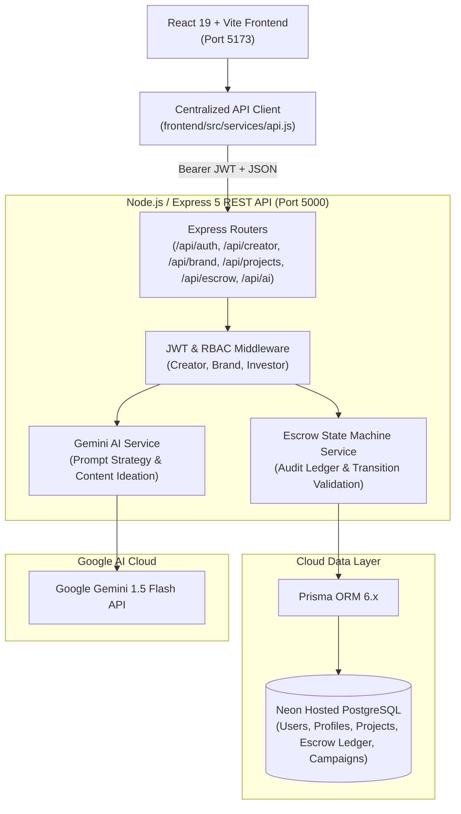
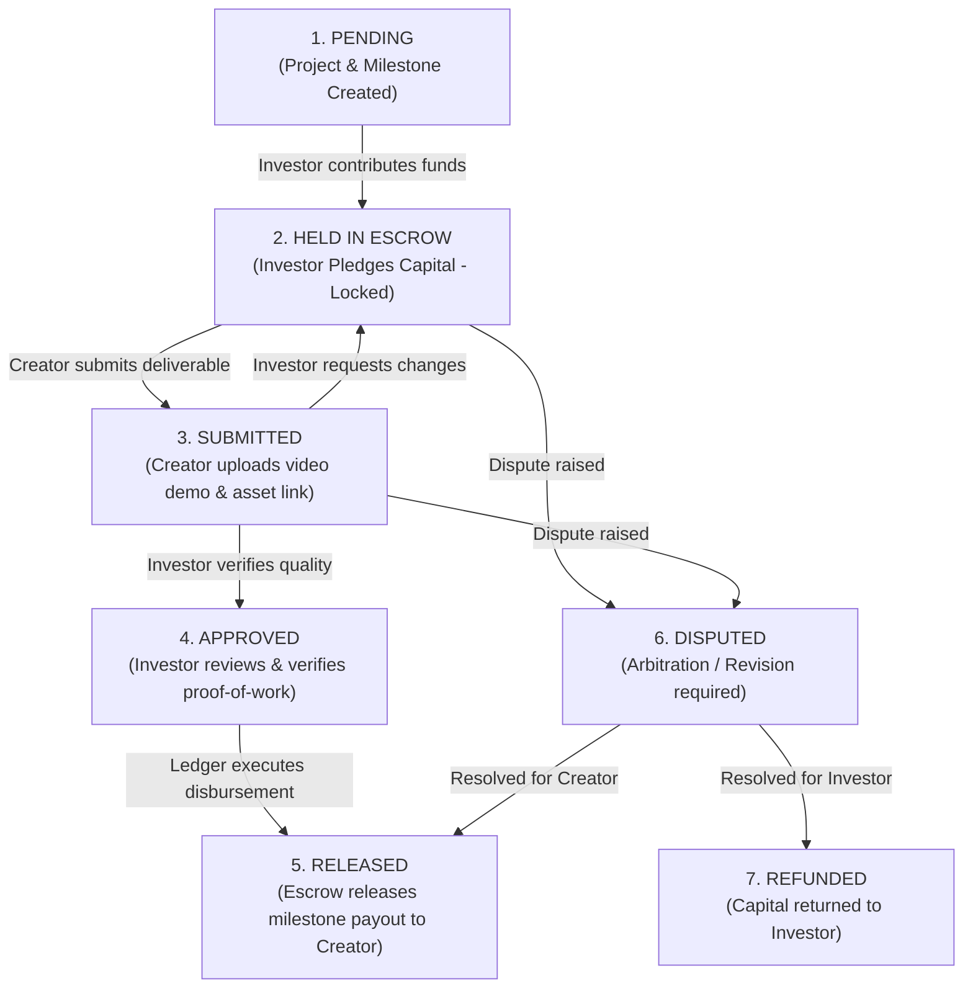

# 🚀 Lazarus V2 — Creator Economy & Brand Escrow Platform

[](https://nodejs.org/)
[](https://expressjs.com/)
[](https://react.dev/)
[](https://vitejs.dev/)
[](https://www.prisma.io/)
[](https://neon.tech/)
[](https://ai.google.dev/)
[](LICENSE)

**Lazarus** is a full-stack, milestone-based creator collaboration and financial escrow platform that connects **Content Creators**, **Sponsoring Brands**, and **Equity Investors**.

Originally started as a hackathon project, **Lazarus V2** has been completely revived and rebuilt with real **Role-Based Access Control (RBAC)**, an auditable **Escrow State Engine**, **Google Gemini AI Content Copilot**, and persistent cloud storage on **Neon Hosted PostgreSQL via Prisma ORM**.

---

## 🌟 Core Value Proposition

In the creator economy, traditional brand deals and funding suffer from two major pain points:
1. **Creators** face delayed payments, scope creep, and arbitrary deliverable rejections after spending upfront capital.
2. **Brands & Investors** take financial risk upfront with no guarantee of quality deliverable delivery or milestone completion.

**Lazarus solves this through milestone escrow:**
- Investors / Brands pledge capital that is **held securely in smart escrow**.
- Creators build content according to pre-approved permitted expense categories.
- Creators submit proof-of-work (video demos, assets).
- Escrow funds are **only disbursed upon verified approval**, preventing fraud for both parties.

---

## 🏗️ Architecture Overview

```text
Lazarus/
├── frontend/                     # React 19 + Vite Frontend Client
│   ├── src/
│   │   ├── components/           # UI Components (ProjectCard, ExpenseList, PayoutTable, etc.)
│   │   ├── pages/                # Role Dashboards (Creator, Brand, Investor, Auth, Projects)
│   │   ├── services/             # Centralized api.js client with JWT interceptor
│   │   └── utils/                # Helper utilities
│   └── package.json
│
├── backend/                      # Node.js + Express Modular REST API
│   ├── prisma/
│   │   └── schema.prisma         # Prisma Schema for Neon Hosted PostgreSQL
│   ├── src/
│   │   ├── controllers/          # Business logic handlers (Auth, Creator, Brand, Project, Escrow, AI)
│   │   ├── routes/               # Modular Express Routers
│   │   ├── services/             # Escrow finite state machine & Gemini assistant
│   │   ├── middleware/           # JWT Authentication, RBAC, Centralized Error Handler
│   │   ├── db/                   # Prisma Client Singleton
│   │   └── server.js             # Express application entrypoint
│   └── package.json
│
├── .env.example                  # Environment template
└── README.md
```

### System Component Diagram



---

## 🔄 The Escrow Lifecycle & State Machine

Every creator project funded on Lazarus is governed by a strict finite state machine that guarantees funds cannot be tampered with or released prematurely:



### State Transition Validation Table

| Current State | Target State | Permitted? | Condition |
| :--- | :--- | :--- | :--- |
| `PENDING` | `HELD` |  Yes | Investor pledges capital to project |
| `HELD` | `SUBMITTED` |  Yes | Creator uploads proof-of-work demo |
| `SUBMITTED` | `APPROVED` |  Yes | Investor verifies deliverable |
| `APPROVED` | `RELEASED` |  Yes | Payout executed, ledger record created |
| `SUBMITTED` | `HELD` |  Yes | Investor requests revisions / changes |
| `RELEASED` | `HELD` | ❌ **Rejected** | **Terminal state — tamper-proof** |
| `RELEASED` | `SUBMITTED`| ❌ **Rejected** | **Terminal state — tamper-proof** |

---

## 👥 Persona Features

### 🎨 1. Creators
- **Agentic AI MOU Signing:** Sign digital legal contracts via interactive canvas (`react-signature-canvas`); signature is stored securely in PostgreSQL.
- **Project Creation:** Launch funding requests with video format, target budget, and itemized permitted expense categories.
- **Niche-Matched Campaign Discovery:** Automatically matches with brand sponsorship campaigns based on selected niches (`#tech`, `#ai`, `#finance`, `#fitness`, etc.).
- **Deliverable Submission:** Upload demo links and notes for investor review.
- **Gemini Content Ideation:** Generate viral video concepts, hooks, and monetization blueprints.

### 🏢 2. Brands
- **Campaign Creation:** Launch sponsor campaigns with deliverables, deadlines, target niches, and budgets.
- **Applicant Evaluation:** View interested creators with subscriber metrics, platforms, and portfolio links.
- **Application Decisions:** Accept or decline creator proposals with real-time status updates.

### 💼 3. Investors
- **Project Exploration:** Browse active creator projects with funding goals and progress bars.
- **Escrow Pledges:** Pledge funding directly into smart escrow hold.
- **Deliverable Verification:** Review submitted video demos; approve to release funds or request revisions.
- **Smart-Contract Revenue Simulator:** Simulate proportional revenue distribution across all project backers based on equity shares.

---

## 🛠️ Tech Stack

| Layer | Technology |
| :--- | :--- |
| **Frontend** | React 19, Vite 7, React Router 7, Recharts, React Signature Canvas |
| **Backend API** | Node.js (v20+ / v22+), Express 5, CORS, Dotenv |
| **Database & ORM**| Neon Hosted PostgreSQL, Prisma ORM 6.x |
| **Authentication** | JSON Web Tokens (JWT), Salted Bcrypt Password Hashing, RBAC Middleware |
| **AI Integration** | Google Gemini 1.5 Flash API (`@google/generative-ai`) |
| **Testing** | Node assert unit tests (Escrow state engine, JWT & RBAC) |

---

## ⚡ Quick Start & Installation

### 1. Prerequisites
- **Node.js**: v18.0.0 or higher (v20+ / v22+ recommended)
- **npm**: v9.0.0 or higher
- **PostgreSQL**: Neon account (free cloud instance) or local PostgreSQL connection string

### 2. Clone the Repository
```bash
git clone https://github.com/devensonawane007/Lazarus.git
cd Lazarus
```

### 3. Environment Setup
Copy `.env.example` to `backend/.env`:
```bash
cp .env.example backend/.env
```

Configure your environment variables in `backend/.env`:
```env
PORT=5000
NODE_ENV=development
FRONTEND_URL=http://localhost:5173

# Neon Hosted PostgreSQL Connection String
DATABASE_URL="postgresql://[user]:[password]@[neon-hostname]/[dbname]?sslmode=require"
DIRECT_URL="postgresql://[user]:[password]@[neon-hostname]/[dbname]?sslmode=require"

# JWT Secret Key
JWT_SECRET="lazarus_super_secret_jwt_key_2026"
JWT_EXPIRES_IN="7d"

# Google Gemini API Key
GEMINI_API_KEY="your_gemini_api_key_here"
```

### 4. Backend Setup & Database Push
```bash
cd backend
npm install
npx prisma generate
npx prisma db push
npm test
```

Start the backend API server:
```bash
npm start
# Server running at http://localhost:5000
```

### 5. Frontend Setup
In a new terminal:
```bash
cd frontend
npm install
npm run build
npm run dev
# Frontend running at http://localhost:5173
```

---

## 📡 API Reference

### 🔐 Authentication (`/api/auth`)
| Method | Endpoint | Access | Description |
| :--- | :--- | :--- | :--- |
| `POST` | `/api/auth/register` | Public | Register new user + initial profile |
| `POST` | `/api/auth/login` | Public | Authenticate user & issue Bearer JWT |
| `GET` | `/api/auth/me` | Authenticated | Get current authenticated user profile |

### 🎨 Creator (`/api/creator`)
| Method | Endpoint | Access | Description |
| :--- | :--- | :--- | :--- |
| `GET` | `/api/creator/profile` | Creator | Fetch own profile & MOU status |
| `POST` | `/api/creator/profile` | Creator | Update niches, platform, followers, views |
| `POST` | `/api/creator/mou` | Creator | Submit digital signature for MOU |
| `GET` | `/api/creator/matched-campaigns` | Creator | Discovery matching brand campaigns |
| `POST` | `/api/creator/apply-campaign` | Creator | Apply to brand campaign |
| `GET` | `/api/creator/profile/:id` | Public | View public creator portfolio |

### 🏢 Brand (`/api/brand`)
| Method | Endpoint | Access | Description |
| :--- | :--- | :--- | :--- |
| `POST` | `/api/brand/campaign` | Brand | Create sponsor campaign |
| `GET` | `/api/brand/campaigns` | Brand | List active campaigns |
| `GET` | `/api/brand/campaign/:id/applicants` | Brand | View applicants for a campaign |
| `PATCH`| `/api/brand/campaign/:id/applications/:appId` | Brand | Accept or decline applicant |

### 🎬 Projects (`/api/projects`)
| Method | Endpoint | Access | Description |
| :--- | :--- | :--- | :--- |
| `POST` | `/api/projects` | Creator | Create project with permitted expenses |
| `GET` | `/api/projects` | Public | List open projects |
| `GET` | `/api/projects/:id` | Authenticated | View complete project details & milestones |

### 💼 Investments & Revenue (`/api/investments`)
| Method | Endpoint | Access | Description |
| :--- | :--- | :--- | :--- |
| `POST` | `/api/investments/contribute` | Investor | Pledge funds into escrow hold |
| `GET` | `/api/investments/dashboard` | Investor | View personal portfolio investments |
| `POST` | `/api/investments/simulate-revenue`| Authenticated | Calculate proportional revenue distributions |

### ⏳ Escrow & Milestones (`/api/escrow`)
| Method | Endpoint | Access | Description |
| :--- | :--- | :--- | :--- |
| `POST` | `/api/escrow/milestones/:id/submit` | Creator | Submit deliverable demo |
| `POST` | `/api/escrow/milestones/:id/approve` | Investor | Approve deliverable -> release escrow funds |
| `POST` | `/api/escrow/milestones/:id/reject` | Investor | Request changes on milestone |
| `GET` | `/api/escrow/projects/:id/transactions` | Authenticated | Auditable transaction ledger |

### 🤖 Gemini AI (`/api/ai`)
| Method | Endpoint | Access | Description |
| :--- | :--- | :--- | :--- |
| `POST` | `/api/ai/ideas` | Authenticated | Generate content & monetization strategy |

---

## ⚖️ Escrow Reality: Simulated Ledger vs. Real Payments

> [!IMPORTANT]
> **Simulated Escrow Architecture Notice**  
> Lazarus V2 currently implements a **Finite State Machine (FSM) Relational Database Ledger Simulation** backed by PostgreSQL transactions (`prisma.$transaction`).  
> 
> - **What it does:** It mathematically enforces financial state transitions (`PENDING -> HELD -> SUBMITTED -> APPROVED -> RELEASED`), logs immutable audit records in `EscrowTransaction`, verifies investor backing before release, and prevents double disbursement.
> - **What it does NOT do:** It does **not** move real fiat currency, process credit cards, or integrate with live banking / gateway providers (such as Stripe, Razorpay, or Finternet). All balances, equity revenue shares, and disbursements are simulated within the PostgreSQL ledger. Real payment gateway integrations are slated for a future production release.

---

## 🔒 Security, RBAC & Anti-IDOR Protections

1. **Server-Side Identity Isolation (Anti-IDOR):** All project creations, profile edits, campaign applications, and application approvals strictly bind to `req.user.id` resolved from the verified JWT. Frontend-supplied ownership IDs are never trusted.
2. **Campaign Ownership Enforcement:** Brands can only inspect applicants and approve/reject applications for campaigns they personally own (`campaign.brandProfileId === brandProfile.id`).
3. **Milestone Escrow Invariance:** Funds cannot transition backwards from `RELEASED` or `REFUNDED` states. Milestone approvals require the reviewer to be a verified investor in that specific project.
4. **Password Security:** Salted hashes with `bcryptjs` (work factor 10). Passwords and password hashes are never returned in JSON payloads.
5. **Zero Client Secrets:** `GEMINI_API_KEY` and database credentials exist strictly on the backend; the Vite frontend client bundle contains zero secret keys.
6. **Strict CORS Policy:** Restricted to trusted frontend origin (`FRONTEND_URL`).

---

## ⚠️ Known Limitations & Deployment Roadmap

1. **Remote Database Configuration:** Active `DATABASE_URL` and `DIRECT_URL` must be configured in `backend/.env` for cloud deployment on Neon PostgreSQL.
2. **Gemini Live Key:** A valid Google Gemini API key is required in `backend/.env` for live AI generation. When missing, the server responds with a structured fallback blueprint without throwing runtime errors.
3. **Third-Party Payment Gateway Integration:** Fiat transfers currently operate via the internal database ledger simulation; production webhook processing (Stripe / Razorpay) is on the roadmap.
4. **Frontend Code Splitting:** Large single-chunk production bundle (668 kB) can be further split into dynamic route chunks via React `lazy()`.

---

## 📜 License
This project is licensed under the [MIT License](LICENSE).

---

## 👨‍💻 Author
**Deven Sonawane**  
GitHub: [@devensonawane007](https://github.com/devensonawane007)
