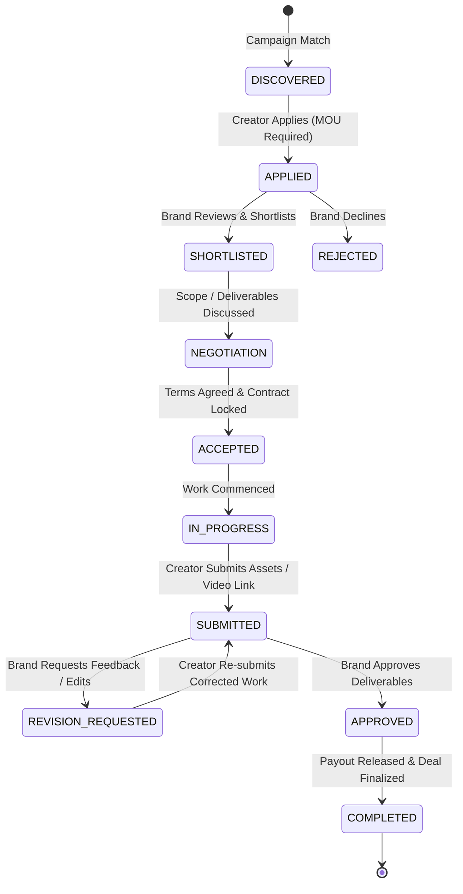

# LAZARUS V3 — CREATOR-BRAND COLLABORATION LIFECYCLE & DEAL ROOM REPORT

**System:** Collaboration Workspace & Deal Room State Machine  
**Service:** `CollaborationService` (`backend/src/services/collaboration.service.js`)  
**Interface:** Creator Studio (Deals Tab) & Collaboration Workspace Route (`/collaborations/:id`)  

---

## 1. 10-Stage Collaboration Lifecycle

Lazarus provides an end-to-end collaboration deal room managing the complete lifecycle of a creator sponsorship from initial discovery to deliverable sign-off and payout.



---

## 2. State Transition Machine & Anti-Tampering Rules

State transitions are governed by a strict transition matrix in `CollaborationService.VALID_TRANSITIONS`:

```javascript
static VALID_TRANSITIONS = {
  DISCOVERED: ["APPLIED", "CANCELLED"],
  APPLIED: ["SHORTLISTED", "REJECTED", "CANCELLED"],
  SHORTLISTED: ["NEGOTIATION", "REJECTED", "CANCELLED"],
  NEGOTIATION: ["ACCEPTED", "REJECTED", "CANCELLED"],
  ACCEPTED: ["IN_PROGRESS", "CANCELLED"],
  IN_PROGRESS: ["SUBMITTED", "CANCELLED"],
  SUBMITTED: ["REVISION_REQUESTED", "APPROVED"],
  REVISION_REQUESTED: ["SUBMITTED", "CANCELLED"],
  APPROVED: ["COMPLETED"],
  COMPLETED: [],
  REJECTED: [],
  CANCELLED: []
};
```

Any attempt to bypass stages (e.g. attempting to jump from `APPLIED` directly to `COMPLETED`, or attempting to re-open a `COMPLETED` deal) throws an immediate validation error:
`Invalid lifecycle transition from APPLIED to COMPLETED. Allowed: [SHORTLISTED, REJECTED, CANCELLED]`.

---

## 3. Deliverable Submission & Brand Review Protocol

### A. Creator Submission Protocol
* **Endpoint:** `POST /api/collaborations/:id/deliverables/:deliverableId/submit`
* **Authorization:** Strict RBAC anti-IDOR check ensuring `deliverable.collaboration.creatorProfile.userId === req.user.id`.
* **Payload:** `{ submissionUrl: "https://...", notes: "..." }`
* **Lifecycle Effect:** Updates deliverable status to `SUBMITTED`, sets collaboration to `SUBMITTED`, and dispatches a notification to the brand owner.

### B. Brand Review Protocol
* **Endpoint:** `POST /api/collaborations/:id/deliverables/:deliverableId/review`
* **Authorization:** Strict RBAC check ensuring `deliverable.collaboration.brandProfile.userId === req.user.id`.
* **Allowed Decisions:** `APPROVED` or `CHANGES_REQUESTED`.
* **Feedback Handling:** If `CHANGES_REQUESTED`, collaboration status is moved to `REVISION_REQUESTED` with brand feedback stored and dispatched to the creator.
* **Auto-Completion:** When all deliverables for a collaboration are approved, the deal status automatically transitions to `COMPLETED`.

---

## 4. Escrow & Milestone Funding Architecture

> [!NOTE]
> **Simulated Milestone Escrow Transparency**
> 
> Lazarus V3 models the complete escrow lifecycle:
> 1. `HELD_IN_ESCROW`: Funds deposited and held upon deal acceptance.
> 2. `RELEASED`: Funds credited to creator upon verified deliverable approval.
> 3. `REFUNDED`: Funds returned upon deal cancellation.
> 
> In testing and sandbox environments, financial transactions are simulated and clearly marked as **"Simulated Escrow Ledger"** in audit logs and frontend receipts, maintaining compliance without fabricating real bank movements.

---

## 5. Automated Audit Trail & Notifications

Every state movement and deliverable review creates:
1. An in-app `Notification` entity for the counterparty (`COLLABORATION_UPDATE`, `DELIVERABLE_SUBMITTED`, `DELIVERABLE_APPROVED`).
2. An immutable `AuditLog` row capturing `actorId`, `resourceType: "COLLABORATION"`, `action`, and `{ previousStatus, newStatus, note }`.
