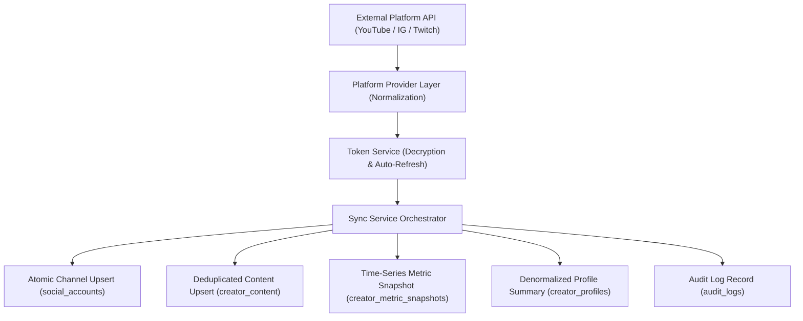

# LAZARUS V3 — DATA INGESTION & PIPELINE ARCHITECTURE

**System:** Cross-Platform Creator Data Synchronization Pipeline  
**Storage Engine:** Neon PostgreSQL via Prisma ORM 6  
**Implementation Modules:** `sync.service.js`, `metrics.service.js`, `token.service.js`  

---

## 1. High-Level Ingestion Pipeline

The data ingestion pipeline transforms unstructured responses from external social APIs (YouTube, Instagram, Twitch) into normalized, relational entities within Neon PostgreSQL.



---

## 2. Ingestion Stages & Transaction Boundaries

### Stage 1: Status Initialization
When a sync job starts, the `social_accounts` record status is set to `SYNC_PENDING` to provide immediate feedback to the creator studio frontend.

### Stage 2: Token Resolution & Auto-Refresh
The `TokenService` retrieves the AES-256-GCM encrypted credential bundle, verifies AAD binding, and checks if `tokenExpiresAt` is within 5 minutes of expiration. If expired, it triggers `provider.refreshToken()`, persists the new encrypted bundle, and yields a valid bearer token.

### Stage 3: Channel Profile Upsert
Fetches current handle, avatar URL, subscriber count, and lifetime views. Updates `social_accounts` with `lastSyncedAt: new Date()` and clears any prior `syncError`.

### Stage 4: Deduplicated Content Library Upsert
Videos and posts are ingested using an atomic database upsert on the composite unique key:
`@@unique([creatorProfileId, platform, externalContentId])`

```javascript
await prisma.creatorContent.upsert({
  where: {
    creatorProfileId_platform_externalContentId: {
      creatorProfileId: account.creatorProfileId,
      platform: account.platform,
      externalContentId: item.externalContentId
    }
  },
  update: {
    title: item.title,
    viewCount: item.viewCount,
    likeCount: item.likeCount,
    commentCount: item.commentCount,
    metricsJson: item.metricsJson
  },
  create: { ...item }
});
```
This guarantees that repeated synchronizations never produce duplicate video records; existing records are updated in place with fresh metrics.

### Stage 5: Time-Series Metric Snapshots
Every sync writes a new immutable row to `creator_metric_snapshots`:
* `followerCount`: Verified audience at snapshot time.
* `totalViews`: BigInt lifetime views across all media.
* `engagementRate`: Verified weighted percentage.
* `watchTimeMinutes`: Verified private analytics watch time.
* `snapshotDate`: Timestamp of snapshot creation.

These snapshots power the historical growth curves in the Creator Studio analytics tab.

### Stage 6: Denormalized Creator Profile Summary
To ensure fast rendering of creator cards and search queries, denormalized summary metrics on `creator_profiles` are updated:
* `followers`: String representation of aggregate verified reach.
* `avgViews`: Recent average video views.

### Stage 7: Immutable Audit Trail
Every sync logs an audit event:
* `action`: `SOCIAL_ACCOUNT_SYNC_SUCCESS` or `SOCIAL_ACCOUNT_SYNC_FAILED`.
* `actorId`: User ID of the creator initiating the sync.
* `detailsJson`: Items synced, followers, views, snapshot ID, or failure stack trace.

---

## 3. Database Schema Mapping

```
social_accounts
  ├── id (UUID, PK)
  ├── creatorProfileId (FK -> creator_profiles)
  ├── platform ("YOUTUBE" | "INSTAGRAM" | "TWITCH")
  ├── platformAccountId (Channel / User ID)
  ├── username (@handle)
  ├── displayName (Channel Name)
  ├── status (CONNECTED | SYNC_PENDING | SYNC_FAILED | EXPIRED | DISCONNECTED)
  ├── lastSyncedAt (DateTime)
  └── syncError (Text?)

social_credentials
  ├── id (UUID, PK)
  ├── socialAccountId (FK -> social_accounts, Unique)
  ├── encryptedAccessToken (AES-256-GCM Ciphertext)
  ├── encryptedRefreshToken (AES-256-GCM Ciphertext)
  ├── tokenExpiresAt (DateTime?)
  ├── iv (12-byte hex)
  └── tag (16-byte hex)

creator_content
  ├── id (UUID, PK)
  ├── creatorProfileId (FK -> creator_profiles)
  ├── platform (SocialPlatform)
  ├── externalContentId (Video / Media ID)
  ├── title, description, thumbnailUrl, contentUrl
  ├── viewCount, likeCount, commentCount (Int)
  └── @@unique([creatorProfileId, platform, externalContentId])

creator_metric_snapshots
  ├── id (UUID, PK)
  ├── creatorProfileId (FK -> creator_profiles)
  ├── platform (SocialPlatform)
  ├── followerCount (Int)
  ├── totalViews (BigInt)
  ├── engagementRate (Float)
  └── snapshotDate (DateTime)
```
