# LAZARUS V3 — SCROLL STORY: GENUINE SCROLL-SCRUBBED PRODUCT NARRATIVE
**Forensic Verification & Scrubbed Timeline Audit Report**  
**Audit Date:** 2026-11-24  
**Engine:** GSAP 3.15 + ScrollTrigger Scrubbed Timeline  
**Interaction Model:** Genuine Continuous Scroll Scrubbing (Direct Wheel/Touch Scrub, Forward & Reverse)  
**Theme Matrix:** Light Mode (Default Baseline) & Dark Mode (`#090d16` Deep Obsidian)  
**Viewport Validation:** Desktop (1440 × 900 px) & Mobile Stacked (390 × 844 px)  
**Accessibility:** WCAG 2.2 AA Verified & `@media (prefers-reduced-motion: reduce)`

---

## 1. EXECUTIVE SUMMARY & INTERACTION MODEL

The Lazarus homepage scroll story has been completely re-engineered from an entrance-animation model into a **genuine, scroll-scrubbed, pinned product storytelling experience** (`frontend/src/components/landing/InteractiveScrollStory.jsx`).

### The Core Interaction Model:
1. **Persistent Pinned Stage:** The right-column preview stage is pinned via `position: sticky; top: 152px; height: 610px`. As the user scrolls through the 4468px narrative track on the left, the stage remains anchored and directly controlled by scroll position.
2. **Direct Scrub Timeline:** Scroll position directly drives a normalized **100-unit master GSAP timeline** (`scrub: 0.6`).
   - Scrolling down continuously advances the transformation across all 6 chapters.
   - Scrolling up reverses the transformation in exact reverse sequence.
   - Elements smoothly transform, converge, draw, expand, fill, and settle without abrupt jumps or uncalibrated pop-ins.
3. **Zero Ghosting & Zero Layer Bleed:**
   - Each of the 6 scene layers has an opaque `backgroundColor: "var(--bg-surface)"`, matching rounded corners `borderRadius: "var(--radius-xl)"`, and dedicated `zIndex` (1 through 6).
   - Inactive layers are strictly hidden via GSAP `autoAlpha: 0` (`visibility: hidden; opacity: 0; pointer-events: none`).
   - Incoming layers fade in smoothly over previous layers with zero transparency bleed or click interception.
4. **Mobile Responsiveness:**
   - On screens `< 992px`, desktop pinned scrolling is gracefully disabled.
   - Instead, mobile visitors get a dedicated stacked, responsive experience where each chapter narrative item includes its own clean, static inline card (`.scroll-story-mobile-preview`).
   - Zero horizontal overflow, zero scroll hijacking, zero jitter.
5. **Reduced Motion Respect:**
   - Evaluates `prefers-reduced-motion: reduce`. When active, GSAP scrub animations are gracefully disabled.

---

## 2. MASTER 100-UNIT SCRUBBED TIMELINE ARCHITECTURE

```mermaid
flowchart LR
    subgraph CH1["Ch 1: 0 - 12"]
        direction TB
        F1["Scattered Tools Drift\n(PDF, DM, Invoices, YT)"]
    end

    subgraph TR1["12 - 16.5"]
        direction TB
        T1["Cards Converge & Shrink\nNexus Hub Scales In\nSVG Paths Draw (400 -> 0)"]
    end

    subgraph CH2["Ch 2: 16.5 - 28"]
        direction TB
        F2["Nexus Hub Active\nStreaming OAuth Pipeline\nAES-256-GCM Vault"]
    end

    subgraph TR2["28 - 32.5"]
        direction TB
        T2["Hub Collapses Inward\nStudio Dashboard Enters\nKPIs & Area Chart Reveal"]
    end

    subgraph CH3["Ch 3: 32.5 - 45"]
        direction TB
        F3["Creator Studio Active\n48,500 Reach • 7.07% Eng\nDynamic Media Kit Link"]
    end

    subgraph TR3["45 - 49.5"]
        direction TB
        T3["Studio Shifts Left\nMatch Engine Enters\nRadial Gauge Scrubs to 96%"]
    end

    subgraph CH4["Ch 4: 49.5 - 61"]
        direction TB
        F4["Opportunity Match Active\n96% Match • 4 Dimension Bars\nExplainable Match Rationale"]
    end

    subgraph TR4["61 - 65.5"]
        direction TB
        T4["Match Shifts Up\nDeal Room Enters\nStepper Line Draws to Stage 7"]
    end

    subgraph CH5["Ch 5: 65.5 - 78"]
        direction TB
        F5["Deal Room Active\nRevision Note at 02:45\nSimulated Escrow Hold"]
    end

    subgraph TR5["78 - 82.5"]
        direction TB
        T5["Deal Room Resolves\n4-Engine Grid Scales In\nDual CTAs Reveal"]
    end

    subgraph CH6["Ch 6: 82.5 - 100"]
        direction TB
        F6["Creator OS Launchpad\nComplete Platform In Motion\nCreator & Brand CTAs"]
    end

    CH1 --> TR1 --> CH2 --> TR2 --> CH3 --> TR3 --> CH4 --> TR4 --> CH5 --> TR5 --> CH6
```

### Detailed Segment Breakdown:
- **0 to 12 (Chapter 1 — The Fragmented Creator Ecosystem):** Floating tool cards drift slowly with scroll (PDF deck, direct message pitch, YouTube Studio tab, overdue invoice, calendar deadline, and unsynced cloud assets).
- **12 to 16.5 (Transition 1 $\rightarrow$ 2):** Floating cards converge toward the center and scale down (`scale: 0.65`, `y: -30`). The central **Lazarus Integration Hub** scales in with elastic bounce (`scale: 0.4` $\rightarrow$ `1.0`). SVG dashed connecting paths draw from provider nodes (`strokeDashoffset: 400` $\rightarrow$ `0`). Hardware-encrypted AES-256-GCM token vault banner slides in.
- **16.5 to 28 (Chapter 2 — Connect Your Ecosystem):** Nexus Hub active state. YouTube API, Instagram Meta Graph (in review), and Twitch Helix nodes stay connected.
- **28 to 32.5 (Transition 2 $\rightarrow$ 3):** Nexus nodes collapse smoothly inward into the top of the Creator Studio header. Studio Dashboard fades in (`autoAlpha: 1`), revealing live metrics.
- **32.5 to 45 (Chapter 3 — Understand Your Creator Business):** Verified Creator Studio workspace. Shows Alex Rivera (`@alexriveratech`), 48,500 verified reach, 7.07% engagement rate, Recharts 30-day audience curve, top content cards, and verified public media kit link (`lazarus.app/kit/alexrivera`).
- **45 to 49.5 (Transition 3 $\rightarrow$ 4):** Studio workspace shifts left (`x: -20`, `scale: 0.97`). Opportunity Matching Engine enters. Circular SVG radial gauge continuously draws from 0% to 96% (`strokeDashoffset: 251.2` $\rightarrow$ `10.05`). 4 progressive dimension fit bars fill to 100%, 95%, 92%, and 98%.
- **49.5 to 61 (Chapter 4 — The Right Opportunities Should Find You):** Matched brief for Nexus AI Cloud (`₹85,000` budget). Explainable matching dimensions and transparent algorithmic rationale displayed.
- **61 to 65.5 (Transition 4 $\rightarrow$ 5):** Match card shifts upward (`y: -15`). Collaboration Deal Room fades in (`autoAlpha: 1`). Stepper timeline bar scrubs forward across stages 1 through 7. Video draft scrubber bar pins precisely to timestamp `02:45 / 12:48`.
- **65.5 to 78 (Chapter 5 — From Discovery to Collaboration):** Active 9-stage Deal Room. Sponsor revision bubble from Nexus AI Reviewer appears with specific audio feedback at timestamp `02:45`. Simulated milestone escrow status locked in deterministic state machine.
- **78 to 82.5 (Transition 5 $\rightarrow$ 6):** Deal room settles and scales down. Complete 4-quadrant Lazarus operating system launches into position.
- **82.5 to 100 (Chapter 6 — Build Your Creator Business):** Complete Platform Launchpad. Highlights Creator Studio, Opportunity Engine, Deal Room, and Milestone Engine with dedicated dual CTAs (`Join as Creator →` and `Post Brand Brief →`). Timeline is padded out to 100 to guarantee stability and prevent abrupt endings.

---

## 3. PLAYWRIGHT AUTOMATED TEST EXECUTION MATRIX

The test suite in `scratch/capture_scrubbed_story_qa.mjs` was executed against the running dev server at `http://localhost:5173`. All 23 visual captures passed with zero errors:

### Test Suite 1: Forward Scrubbing (Light Mode Baseline)
| Step | Ratio | Screenshot Artifact | Verified State & Visual Progression | Status |
| :--- | :--- | :--- | :--- | :--- |
| **00** | 0.05 | `scrub-00-ch1-scattered-light-desktop.png` | Ch1 active: 6 tilted floating cards drifting with scroll position | **PASS** |
| **01** | 0.14 | `scrub-01-ch1-to-ch2-converge-light-desktop.png` | Transition 1 $\rightarrow$ 2: Cards converging, Nexus Hub scaling in, SVG dashed lines drawing | **PASS** |
| **02** | 0.22 | `scrub-02-ch2-nexus-hub-light-desktop.png` | Ch2 active: Lazarus Nexus Hub with YouTube, Instagram, Twitch nodes & AES-256 banner | **PASS** |
| **03** | 0.30 | `scrub-03-ch2-to-ch3-expand-light-desktop.png` | Transition 2 $\rightarrow$ 3: Hub collapsing inward into Creator Studio dashboard header | **PASS** |
| **04** | 0.39 | `scrub-04-ch3-studio-dashboard-light-desktop.png` | Ch3 active: Alex Rivera Studio, 48.5K reach, 7.07% eng, 30d area chart, media kit link | **PASS** |
| **05** | 0.47 | `scrub-05-ch3-to-ch4-morph-light-desktop.png` | Transition 3 $\rightarrow$ 4: Studio shifting left, Opportunity Match card entering, gauge drawing | **PASS** |
| **06** | 0.55 | `scrub-06-ch4-opportunity-match-light-desktop.png` | Ch4 active: 96% Match circular radial gauge drawn, 4 dimension bars filled, rationale chip | **PASS** |
| **07** | 0.63 | `scrub-07-ch4-to-ch5-dealroom-light-desktop.png` | Transition 4 $\rightarrow$ 5: Match morphing into Deal Room, 9-stage stepper line drawing | **PASS** |
| **08** | 0.72 | `scrub-08-ch5-collaboration-light-desktop.png` | Ch5 active: 9-stage deal room, draft v2 player with scrubber at 02:45, feedback note, escrow lock | **PASS** |
| **09** | 0.80 | `scrub-09-ch5-to-ch6-launch-light-desktop.png` | Transition 5 $\rightarrow$ 6: Deal room resolving into complete 4-engine ecosystem grid | **PASS** |
| **10** | 0.92 | `scrub-10-ch6-launchpad-light-desktop.png` | Ch6 active: 4-quadrant Creator OS in motion, dual CTAs for Creator and Brand registration | **PASS** |

### Test Suite 2: Reverse Scrubbing (Scrolling Back Up)
| Step | Target Ratio | Screenshot Artifact | Verified Reversible Progression | Status |
| :--- | :--- | :--- | :--- | :--- |
| **R1** | 0.55 | `reverse-scrub-ch4-match-desktop.png` | Reversing scroll back to Chapter 4: Match engine returns to full 96% gauge state | **PASS** |
| **R2** | 0.39 | `reverse-scrub-ch3-studio-desktop.png` | Reversing scroll back to Chapter 3: Studio dashboard and growth curve restore seamlessly | **PASS** |
| **R3** | 0.22 | `reverse-scrub-ch2-hub-desktop.png` | Reversing scroll back to Chapter 2: Nexus Hub and SVG provider connection lines restore | **PASS** |
| **R4** | 0.05 | `reverse-scrub-ch1-scattered-desktop.png` | Reversing scroll back to Chapter 1: Scattered tool cards drift back to original positions | **PASS** |

### Test Suite 3: Dark Mode Scrubbing
| Step | Ratio | Screenshot Artifact | Verified Theme Execution | Status |
| :--- | :--- | :--- | :--- | :--- |
| **D1** | 0.22 | `scrub-ch2-nexus-dark-desktop.png` | Dark Mode Nexus Hub: Glowing emerald central node, high-contrast provider nodes | **PASS** |
| **D2** | 0.39 | `scrub-ch3-studio-dark-desktop.png` | Dark Mode Studio: Obsidian surface cards, emerald area chart gradient, verified badges | **PASS** |
| **D3** | 0.55 | `scrub-ch4-match-dark-desktop.png` | Dark Mode Match Engine: Glowing 96% radial gauge ring, high-contrast dimension bars | **PASS** |
| **D4** | 0.72 | `scrub-ch5-dealroom-dark-desktop.png` | Dark Mode Deal Room: Amber revision indicator, 02:45 video player scrubber, escrow lock | **PASS** |
| **D5** | 0.92 | `scrub-ch6-launch-dark-desktop.png` | Dark Mode Launchpad: 4 ecosystem engines and high-contrast dual registration buttons | **PASS** |

### Test Suite 4: Mobile Viewport Stacked Layout (390 × 844 px)
| Step | Screenshot Artifact | Verified Mobile Experience | Status |
| :--- | :--- | :--- | :--- |
| **M1** | `mobile-ch1-scattered.png` | Sticky pane hidden; Chapter 1 status quo alert and overdue invoice card inline | **PASS** |
| **M2** | `mobile-ch3-studio.png` | Sticky pane hidden; Alex Rivera Studio preview card (48.5K reach, 7.07% eng) inline | **PASS** |
| **M3** | `mobile-ch5-collab.png` | Sticky pane hidden; Stage 6 revision card with 02:45 feedback bubble inline | **PASS** |

---

## 4. ZERO GHOSTING & CODE INTEGRITY CONFIRMATION

1. **Root Cause Analysis of Initial Bleed:**
   - In the initial prototype, timeline tweens defaulted to 0.5s without fixed durations, causing the timeline duration to be variable (`~87.5 units`), which misaligned scrub percentages with keyframes.
   - When outgoing layers faded down concurrently with incoming layers, both containers had fractional opacity (`~0.5`), creating a translucent window where underlying graphics bled through.
2. **Resolution Applied:**
   - Calibrated timeline to a strict **100-unit duration** with explicit `duration` and exact start times on every tween.
   - Incoming layers (with solid `var(--bg-surface)` and higher `zIndex`) fade in smoothly over outgoing layers. Once fully opaque, the outgoing layer is strictly removed from the render tree via GSAP `autoAlpha: 0` (`visibility: hidden; opacity: 0; pointer-events: none`).
   - The end of the timeline (82.5 to 100) is padded with a stable rest period so Chapter 6 remains rock-solid stable without abrupt jumps.
3. **Repository Safeguards:**
   - Backend routes, Prisma schemas, and PostgreSQL database were untouched.
   - Zero secrets committed (`.env` remains strictly ignored by Git).
   - Production Vite build verified clean (`vite build` completed in 24.96s, 0 errors).
