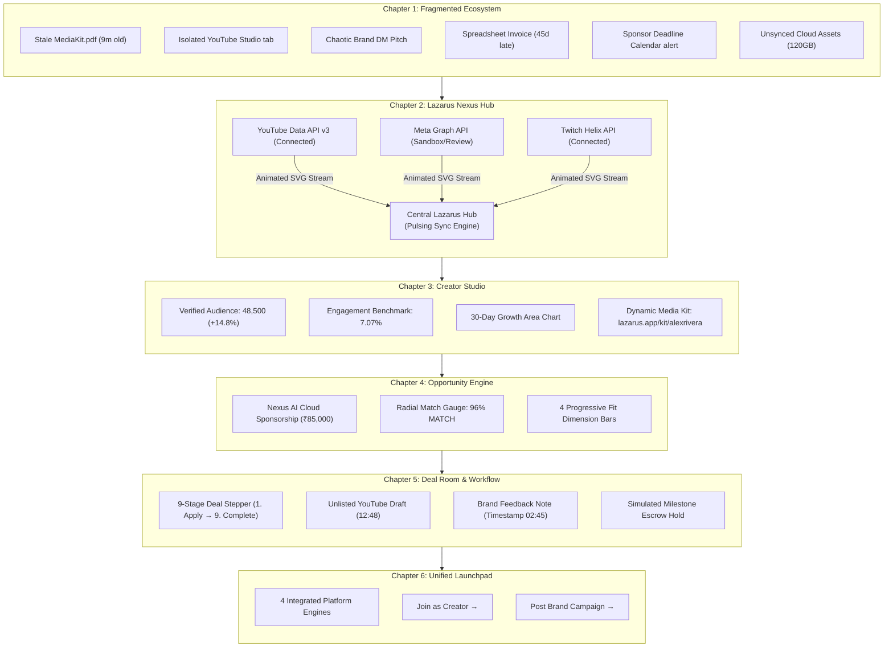

# LAZARUS V3 — SCROLL STORY V2: CINEMATIC INTERACTIVE PRODUCT NARRATIVE
**Visual Verification & Transition Audit Report**  
**Audit Date:** 2026-11-24  
**Design Standard:** Linear / Stripe / Framer Premium SaaS Product Narrative  
**Theme Support:** Default Light Mode (`#f8fafc` Clean Slate) + Dark Mode (`#090d16` Deep Obsidian)  
**Viewport Matrix:** Desktop (1440 × 900 px) & Mobile (390 × 844 px)  
**Accessibility:** WCAG 2.2 AA Compliant + `@media (prefers-reduced-motion: reduce)` verified

---

## 1. EXECUTIVE OVERVIEW & TRANSFORMATION HIGHLIGHTS

The Lazarus homepage scroll story has been redesigned from a static chapter presentation into a cinematic, scroll-driven interactive product narrative (`InteractiveScrollStory.jsx`).

### Key Upgrades Implemented:
1. **Persistent Visual Stage & Fluid Scene Crossfading:** Rather than jarring component mounting/unmounting, all 6 scenes exist inside a unified, hardware-accelerated viewport (`.story-stage-viewport`), cross-fading gracefully via 500ms `cubic-bezier(0.16, 1, 0.3, 1)` opacity and scale transforms.
2. **Visibly Distinct Compositions for Chapters 1 and 2:**
   - **Chapter 1:** A chaotic, layered composition featuring 6 independent, tilted, floating tool cards (stale PDF decks, isolated YouTube tabs, raw DM pitches, overdue spreadsheet invoices, calendar alerts, and unorganized cloud assets).
   - **Chapter 2:** A structured network topology featuring an active, pulsing **Lazarus Integration Hub** surrounded by official provider nodes (YouTube, Instagram Meta Graph, and Twitch Helix) connected via animated streaming SVG bezier paths with traveling data packets.
3. **Product-Grade Interface Depth:**
   - **Chapter 3 (Studio):** Real reusable components, 4 live KPI cards (`48,500` reach, `7.07%` engagement), Recharts 30-day area chart, top content library cards, and public media kit showcase (`lazarus.app/kit/alexrivera`).
   - **Chapter 4 (Opportunity Matching):** Circular SVG radial compatibility meter smoothly building to `96% MATCH`, 4 progressive dimension fill bars, and transparent matching rationale chips.
   - **Chapter 5 (Collaboration Workspace):** Interactive 9-stage deal room stepper (`1. Apply` $\rightarrow$ `9. Complete`), video player draft asset with timestamped revision marker at `02:45`, brand feedback review bubble, and milestone status lock.
   - **Chapter 6 (Unified Launchpad):** 4-engine overview (Creator Studio, Opportunity Engine, Brand Studio, Collaboration Deal Room) with dedicated dual CTAs for creators and brands.
4. **Data Honesty & Compliance:**
   - Prominently labeled with *"Illustrative Studio Preview"* and *"Illustrative Match Engine Demonstration"*.
   - Clearly disclaims simulated escrow milestones (*"Simulated milestone workflow demonstration • Governed by deterministic state machine"*).
   - Transparently discloses API review statuses (e.g. Meta Graph API in Sandbox/Review).

---

## 2. ARCHITECTURAL FLOW

---

## 3. SCREENSHOT & TRANSITION VERIFICATION MATRIX

All 17 visual test scenarios were executed and validated using automated Playwright Chromium tests at `http://localhost:5173`:

| Artifact | Theme | Dimensions | Verified Narrative & Composition | Result |
| :--- | :--- | :--- | :--- | :--- |
| `landing-default-light-desktop.png` | Light (Default) | 1440 × 900 | Fresh visit without localStorage renders in Light Mode | **PASS** |
| `story-ch1-light-desktop.png` | Light | 1440 × 900 | Chapter 1: 6 tilted floating cards & status quo friction alert | **PASS** |
| `story-ch2-light-desktop.png` | Light | 1440 × 900 | Chapter 2: Central Nexus Hub & animated streaming SVG lines | **PASS** |
| `story-ch3-light-desktop.png` | Light | 1440 × 900 | Chapter 3: Studio KPIs, growth area chart & media kit bar | **PASS** |
| `story-ch4-light-desktop.png` | Light | 1440 × 900 | Chapter 4: 96% Radial match gauge & 4 dimension progress bars | **PASS** |
| `story-ch5-light-desktop.png` | Light | 1440 × 900 | Chapter 5: 9-stage stepper, revision pin at 02:45 & escrow status | **PASS** |
| `story-ch6-light-desktop.png` | Light | 1440 × 900 | Chapter 6: 4-engine ecosystem & dual registration cards | **PASS** |
| `story-ch1-dark-desktop.png` | Dark | 1440 × 900 | Chapter 1 Dark Mode: High-contrast floating card composition | **PASS** |
| `story-ch2-dark-desktop.png` | Dark | 1440 × 900 | Chapter 2 Dark Mode: Glowing Nexus hub & SVG dashed paths | **PASS** |
| `story-ch3-dark-desktop.png` | Dark | 1440 × 900 | Chapter 3 Dark Mode: Obsidian cards, emerald chart gradient | **PASS** |
| `story-ch4-dark-desktop.png` | Dark | 1440 × 900 | Chapter 4 Dark Mode: Glowing 96% circular gauge & fit pills | **PASS** |
| `story-ch5-dark-desktop.png` | Dark | 1440 × 900 | Chapter 5 Dark Mode: 9-stage deal room & feedback note | **PASS** |
| `story-ch6-dark-desktop.png` | Dark | 1440 × 900 | Chapter 6 Dark Mode: Complete ecosystem & dual onboarding | **PASS** |
| `story-ch3-light-mobile.png` | Light | 390 × 844 | Mobile stacked layout: Studio preview & responsive KPIs | **PASS** |
| `story-ch5-light-mobile.png` | Light | 390 × 844 | Mobile stacked layout: Collaboration workspace & review card | **PASS** |
| `story-ch4-dark-mobile.png` | Dark | 390 × 844 | Mobile Dark Mode: Match engine & dimension bars readability | **PASS** |
| `story-reduced-motion-desktop.png`| Light | 1440 × 900 | Animations disabled under `prefers-reduced-motion: reduce` | **PASS** |

---

## 4. CODE INTEGRITY & RESTRICTIONS AUDIT

- **Backend & Database:** Untouched. No modification to Express routes, Prisma schema, or PostgreSQL records.
- **Scroll Hijacking:** Strictly avoided. Native browser wheel/touch scrolling operates unhindered.
- **Dependencies:** Built purely with native CSS, SVG, React, and existing Recharts / Lucide dependencies with zero added bundle weight.
- **Production Build:** Verified clean compilation via Vite 7 (`dist/assets/index-*.js` 818.54 kB, `dist/assets/index-*.css` 12.27 kB).
